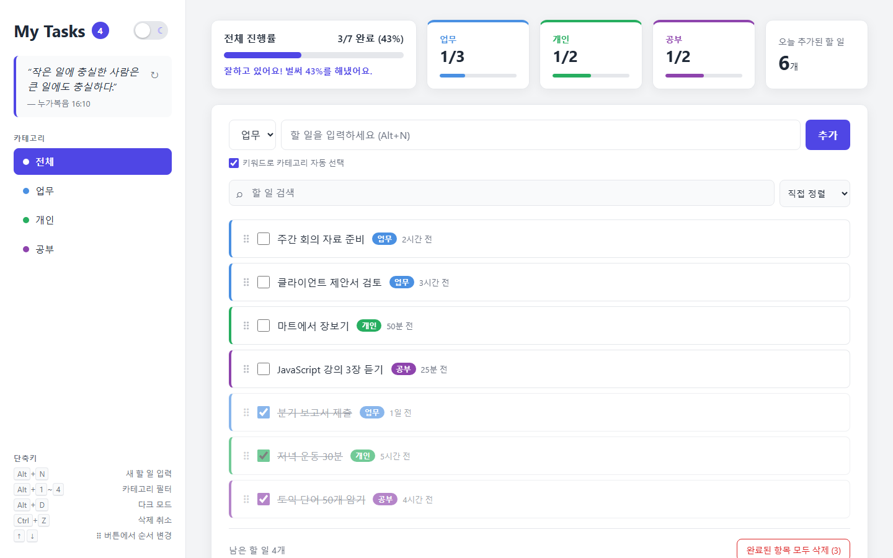
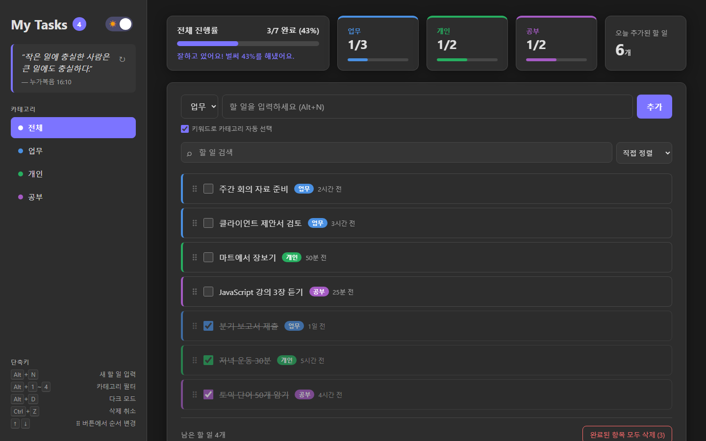
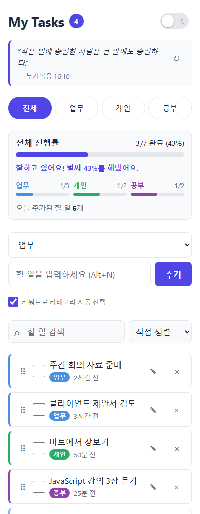

# My Tasks — 할 일 관리 앱

카테고리, 진행률 대시보드, 키워드 자동 분류를 지원하는 할 일 관리 웹 앱입니다.
빌드 과정이나 서버 없이 HTML·CSS·JavaScript 파일만으로 동작합니다.

**▶ 바로 사용하기: https://hwangtw1964-byte.github.io/todolist/**

## 스크린샷

**데스크톱 (라이트 모드)**



**데스크톱 (다크 모드)**



**모바일**



## 주요 기능

**할 일 관리**
- 할 일 추가 (Enter 또는 추가 버튼), 완료 체크, 삭제
- 더블클릭 또는 ✎ 버튼으로 내용·카테고리 수정 (Enter 저장, Esc 취소)
- 같은 내용의 할 일을 추가하면 중복 확인
- 삭제 후 알림의 "실행 취소" 버튼 또는 `Ctrl+Z`로 복구 (최근 20개 작업)
- 완료된 항목 한 번에 삭제 (확인 창 + 실행 취소 가능)

**카테고리**
- 업무 · 개인 · 공부, 카테고리별 색상 태그와 필터
- 입력한 내용의 키워드로 카테고리 자동 선택 (예: "팀 회의 준비" → 업무, "마트 장보기" → 개인)
  - 직접 고른 카테고리가 항상 우선하며, 체크박스로 끌 수 있습니다

**대시보드**
- 전체 진행률(완료/전체, %)과 진행률 바, 카테고리별 진행률
- 오늘 추가한 할 일 개수, 완료율에 따른 응원 메시지
- 날짜마다 바뀌는 오늘의 격언

**검색 · 정렬**
- 실시간 검색 (일치하는 부분 강조)
- 직접 정렬(⠿ 핸들을 끌어서 순서 변경, 마우스·터치 지원) · 최신순 · 오래된순 · 카테고리순 · 완료 상태순
- 직접 정렬에서는 완료한 항목이 자동으로 아래로 이동합니다

**그 밖에**
- 다크 모드 (설정 저장, 처음에는 운영체제 설정을 따름)
- JSON 파일로 내보내기 / 가져오기 (가져오기 전 현재 데이터 백업 선택, 대체 또는 합치기)
- 데스크톱(사이드바 레이아웃)과 모바일 화면 모두 지원
- 키보드 조작과 스크린 리더 지원, 운영체제의 "애니메이션 줄이기" 설정 존중

## 키보드 단축키

| 단축키 | 동작 |
|---|---|
| `Alt` + `N` | 새 할 일 입력창으로 이동 |
| `Alt` + `1` ~ `4` | 필터 전환 (전체 / 업무 / 개인 / 공부) |
| `Alt` + `D` | 다크 모드 전환 |
| `Ctrl` + `Z` | 삭제 실행 취소 (입력창 밖에서) |
| `↑` / `↓` | ⠿ 버튼에 포커스한 상태에서 순서 변경 |

## 데이터 저장

할 일은 서버가 아니라 **사용하는 브라우저의 localStorage**에 저장됩니다.

- 다른 사람과 데이터가 공유되지 않으며, 다른 기기나 다른 브라우저에서는 보이지 않습니다.
- 브라우저의 사이트 데이터를 지우면 할 일도 함께 지워집니다. 중요한 데이터는 "내보내기 (JSON)"로 백업해 두세요.
- 다른 기기로 옮기려면 내보낸 JSON 파일을 그 기기에서 "가져오기" 하면 됩니다.

## 로컬에서 실행하기

저장소를 내려받은 뒤 `index.html`을 브라우저로 열면 됩니다. 설치나 빌드는 필요 없습니다.

```bash
git clone https://github.com/hwangtw1964-byte/todolist.git
cd todolist
# index.html을 브라우저로 열기
```

## 파일 구성

| 파일 | 내용 |
|---|---|
| `index.html` | 화면 구조 |
| `style.css` | 기본 스타일 (색상 테마, 컴포넌트, 모바일 화면) |
| `desktop.css` | 너비 900px 이상 데스크톱 레이아웃 |
| `script.js` | 앱 기능 전체 |

### 자동 분류 키워드 바꾸기

`script.js` 위쪽의 `CATEGORY_KEYWORDS`에 카테고리별 키워드 목록이 있습니다.
배열에 소문자로 단어를 추가하면 바로 반영됩니다.

```js
const CATEGORY_KEYWORDS = {
  work: ['회의', '미팅', '보고서', ...],
  personal: ['장보기', '운동', ...],
  study: ['공부', '강의', ...],
};
```
